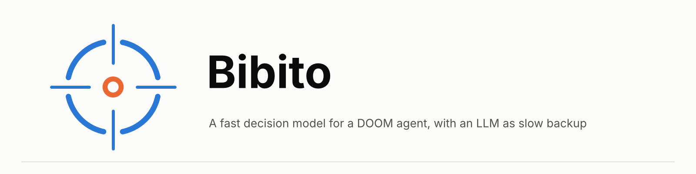
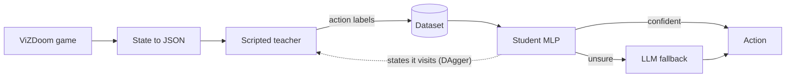
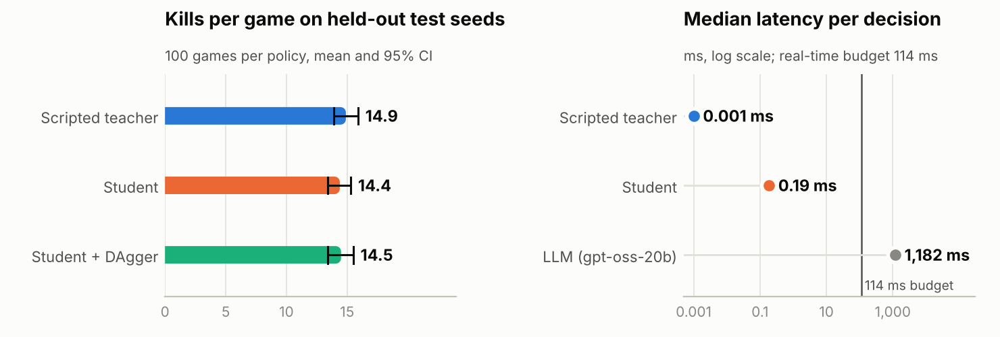
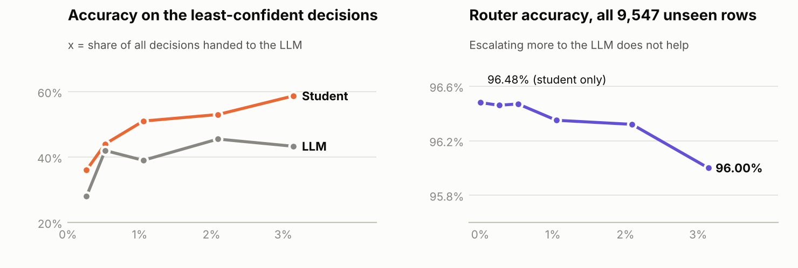

<div align="center">

<picture>
  <source media="(prefers-color-scheme: dark)" srcset="docs/banner-dark.png">
  
</picture>

A tiny neural network learns from a slower decision-maker and answers in about 0.1 ms.
Built and measured on ViZDoom (`defend_the_center`).


[](https://github.com/ahmed-askri/bibito/actions)

[Results](#results) · [How it works](#how-it-works) · [Findings](#key-findings) · [Quickstart](#quickstart) · [Next steps](#scope-and-next-steps)

</div>

---

## At a glance

<table>
  <tr>
    <td align="center"><h3>~97%</h3>of the teacher's score<br>(14.4 vs 14.9 kills, test seeds)</td>
    <td align="center"><h3>0.1-0.2 ms</h3>per decision<br>(LLM: ~1,180 ms)</td>
    <td align="center"><h3>96.5% → 97.9%</h3>agreement on unseen states<br>after 3 DAgger rounds</td>
    <td align="center"><h3>56%</h3>LLM agreement with the<br>teacher (student: 95%)</td>
  </tr>
</table>

Every number in this repository was measured here, on held-out seeds, with confidence intervals.

## Highlights

- **Fast.** A 14-input MLP imitates a scripted teacher and decides in 0.1-0.2 ms, well inside the 114 ms
  real-time budget (4-tic frame skip). An LLM took ~1.2 s per decision.
- **Rigorous evaluation.** Same-seed comparisons, bootstrap confidence intervals, paired differences,
  latency percentiles, MLflow tracking, unit tests and CI on every push.
- **Caught a data leak.** Different seeds often produce identical games, so a split by seed leaked:
  66% of validation states were also in training. Checking exact-state overlap fixed it, and all
  agreement figures use unseen states only.
- **Complete experiment loop.** Teacher, dataset, student, DAgger, LLM comparison and a confidence router,
  each measured on its own.

## How it works



| Step | What it does |
|---|---|
| **1. State to JSON** | Game state becomes a small structured state: ammo, health, and visible enemies with distance and angle relative to the player. |
| **2. Teacher** | A scripted bot: aim at the best target, shoot within 5 degrees of straight ahead. |
| **3. Dataset** | (state, teacher action) pairs. Test seeds are never used for training or tuning. |
| **4. Student** | A small MLP (14 inputs → 64 → 64 → 3 actions) trained to imitate the teacher. |
| **5. DAgger** | The student plays, the teacher labels the states the student visited, then the student is retrained. |
| **6. Router** | The student's confidence decides when to hand a decision to an LLM. |
| **7. Evaluation harness** | Same seeds for every policy, confidence intervals, latency, tracking, tests and CI. |

## Results

`defend_the_center`, 100 games per policy, frame skip 4. Kills = monsters killed. Held-out **test** seeds
9000-9099, each model evaluated once.

<p align="center">
  <picture>
    <source media="(prefers-color-scheme: dark)" srcset="docs/results-dark.png">
    
  </picture>
</p>

| Policy | Kills (95% CI) | vs teacher (paired) | Latency p50 |
|---|---|---|---|
| Scripted teacher | 14.9 (13.9-15.9) | n/a | 0.001-0.004 ms |
| Student (MLP) | 14.4 (13.4-15.3) | -0.55 (-0.91 to -0.23) | 0.09-0.19 ms |
| Student + DAgger (3 rounds) | 14.5 (13.4-15.5) | -0.44 (-0.97 to +0.03) | 0.09-0.19 ms |

Agreement with the teacher on **unseen states** (offline):

| Model | Agreement |
|---|---|
| Student | 96.5% |
| Student + DAgger | 97.9% |
| LLM (gpt-oss-20b, 100 sampled rows) | 56.0% |

All policies die in every game: with 26 bullets and melee enemies that keep coming, surviving to the
time limit is not realistic, so the metric is kills.

## Key findings

**The teacher is a hard baseline.** A 10-line rule is free (~0.002 ms) and strong. The LLM, given no
rule, was slower and less accurate, so distilling the rule into a small network was the better design.

**The student knows when it is unsure.** Its least-confident predictions are right only 36-59% of the
time, against 96.5% overall. That makes its confidence a usable routing signal.

**An LLM fallback did not pay off in this scenario.** I escalated the k least-confident decisions to the
LLM and measured exact accuracy on all 9,547 unseen validation rows. The LLM was weaker than the student
on those rows in every bucket, so the router stayed at or below student-only accuracy.

<p align="center">
  <picture>
    <source media="(prefers-color-scheme: dark)" srcset="docs/router-dark.png">
    
  </picture>
</p>

**DAgger improved agreement but not score.** Agreement with the teacher on unseen states went from
96.5% to 97.9% while kills stayed flat (test: 14.4 vs 14.5). Agreement is not game score, and a student
trained on a teacher's labels is bounded by that teacher.

<details>
<summary><b>DAgger round by round (validation seeds 2000-2099)</b></summary>

| Model | Kills (95% CI) | Agreement, unseen states | Paired vs round 0 |
|---|---|---|---|
| Teacher | 15.2 (14.3-16.1) | n/a | n/a |
| Round 0 (teacher data only) | 15.7 (14.8-16.4) | 96.5% | n/a |
| Round 1 (+25,621 rows) | 15.6 (14.8-16.4) | 96.9% | -0.03 (-0.33 to +0.31) |
| Round 2 (+50,639 rows) | 15.2 (14.3-16.1) | 97.8% | -0.42 (-0.85 to -0.07) |
| Round 3 (+74,776 rows) | 15.4 (14.5-16.2) | 97.9% | -0.24 (-0.61 to +0.07) |

Rollouts use 10% random actions to visit states the student alone would not reach; labels always come
from the teacher.
</details>

## Scope and next steps

| Area | Where it stands | Next |
|---|---|---|
| **Scenarios** | `basic` to build the pipeline, `defend_the_center` for the experiments | Harder scenarios such as `deadly_corridor` |
| **Input** | Symbolic JSON state | A CNN student that plays from frames |
| **Teacher** | Scripted rule | A PPO-trained teacher that can outperform the rule, where distillation is most useful |
| **Router** | Evaluated offline against teacher labels | In-game router test, a stronger LLM, calibration (temperature scaling, ECE) |
| **Statistics** | About 50 distinct results per 100 games, so intervals are indicative | More independent scenario variations |
| **Deployment** | Local scripts, tracked with MLflow | FastAPI + Docker serving, model registry, drift monitoring, retrain loop |

LLM numbers come from a free-tier provider with rate limits (they include retry waits); token prices
are taken from third-party trackers.

## Quickstart

Use Python 3.11 or 3.12 (ViZDoom has no wheel for 3.15).

```powershell
python -m venv venv
venv\Scripts\Activate.ps1
python -m pip install -r requirements.txt mlflow
python -m pytest -q

python -u build_dataset.py defend_the_center 200     # teacher plays, dataset is recorded
python -u train_student.py defend_the_center         # student imitates the teacher
python -u run_eval.py defend_the_center 100          # same-seed evaluation, MLflow tracking
python -u run_dagger.py                              # DAgger: 3 rounds, compared with round 0
```

`data/`, `models/` and `results/` are not in the repository; the commands above regenerate them.
LLM experiments need a `GROQ_API_KEY` in `.env` (copy `.env.example`; never commit `.env`).

## Repository layout

```text
bibito/
├── bibito/
│   ├── state.py        game state to JSON
│   ├── scenarios.py    scenario definitions
│   ├── policies.py     random, scripted teacher
│   ├── evaluate.py     play episodes, latency
│   ├── harness.py      bootstrap CI, paired differences
│   ├── dataset.py      recording and JSONL I/O
│   ├── student.py      MLP, training, policy
│   ├── dagger.py       DAgger rollout
│   ├── llm.py          LLM policy
│   └── router.py       confidence-based escalation
├── tests/              unit tests (run in CI)
├── build_dataset.py  train_student.py  run_eval.py  run_dagger.py
├── llm_agreement.py  router_curve.py  check_overlap.py
└── docs/               figures used in this README
```

## Stack

Python · PyTorch · ViZDoom · MLflow · pytest · GitHub Actions · OpenAI-compatible client for LLM calls
